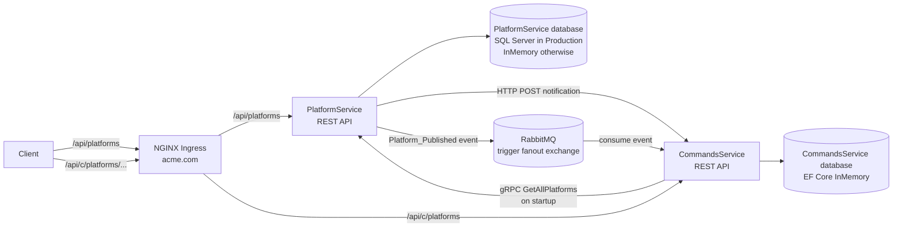

# Platform Microservices

## Purpose

This project is a small .NET microservices example for managing software platforms and the command-line instructions associated with them.

- **PlatformService** is the source of truth for platform records (name, publisher, and cost). It exposes a REST API and a gRPC endpoint.
- **CommandsService** keeps a local copy of platform records and stores command instructions linked to those platforms. It exposes REST endpoints for listing platforms and managing commands.
- The services demonstrate synchronous HTTP and gRPC communication alongside asynchronous event delivery through RabbitMQ.

## Tech stack

| Area | Technology |
|---|---|
| Services and APIs | C#, ASP.NET Core Web API, .NET 5 |
| Persistence and data access | Entity Framework Core 5; SQL Server for PlatformService in Production; EF Core InMemory for development and CommandsService |
| Synchronous service communication | HTTP client and gRPC with Protocol Buffers |
| Asynchronous messaging | RabbitMQ, using a fanout exchange |
| Object mapping and API documentation | AutoMapper and Swagger / Swashbuckle |
| Containers and orchestration | Docker and Kubernetes |
| Edge routing | Kubernetes Ingress configured for NGINX |

> **Runtime note:** .NET 5 is out of support. Review and upgrade the target framework and dependencies before using this project as the basis for a production system.

## Architecture



In the Kubernetes manifests, `PlatformService` is exposed internally by a ClusterIP service on HTTP port 80 and gRPC port 666. `CommandsService` is exposed internally on port 80. The ingress routes the two REST API path prefixes to the appropriate service.

## Workflow

### Creating a platform

1. A client submits `POST /api/platforms` to PlatformService.
2. PlatformService maps the request to a platform model and saves it to its database.
3. PlatformService makes an HTTP POST to the CommandsService platforms endpoint as a synchronous connectivity notification. The current receiving endpoint logs the request and responds; it does not persist the platform.
4. PlatformService publishes a `Platform_Published` message containing the platform data to RabbitMQ's `trigger` fanout exchange.
5. CommandsService's background subscriber receives the message. Its event processor checks whether the external platform ID already exists and, if not, stores the platform in its local database.

### Initial platform synchronization

When CommandsService starts, it calls PlatformService's gRPC `GetAllPlatforms` method and copies platforms not already present into its local database. The same gRPC service can return all platforms on request.

### Working with commands

1. A client lists CommandsService platforms with `GET /api/c/platforms`.
2. To list commands for a platform, it sends `GET /api/c/platforms/{platformId}/commands`.
3. To create a command, it sends `POST /api/c/platforms/{platformId}/commands`. CommandsService verifies that the platform exists locally, saves the command, and associates it with that platform.
4. A command can be retrieved with `GET /api/c/platforms/{platformId}/commands/{commandId}`.

## Project layout

```text
PlatformService/PlatformService/   Platform REST API, gRPC server, and platform data access
CommandsService/CommandsService/   Commands REST API, RabbitMQ consumer, and gRPC client
K8S/                               Kubernetes deployments, services, storage, and ingress
```

## Implementation notes

- PlatformService uses EF Core InMemory outside Production and SQL Server in Production; it applies migrations during production startup.
- CommandsService is configured to use EF Core InMemory in all environments in the current code. Its local platform and command data is therefore not durable across service restarts.
- The HTTP POST sent while creating a platform is separate from the RabbitMQ event that updates CommandsService's local platform data.
- The Kubernetes manifests reference prebuilt container images. SQL Server deployment also expects an `mssql` Kubernetes Secret containing the `SA_PASSWORD` key.
